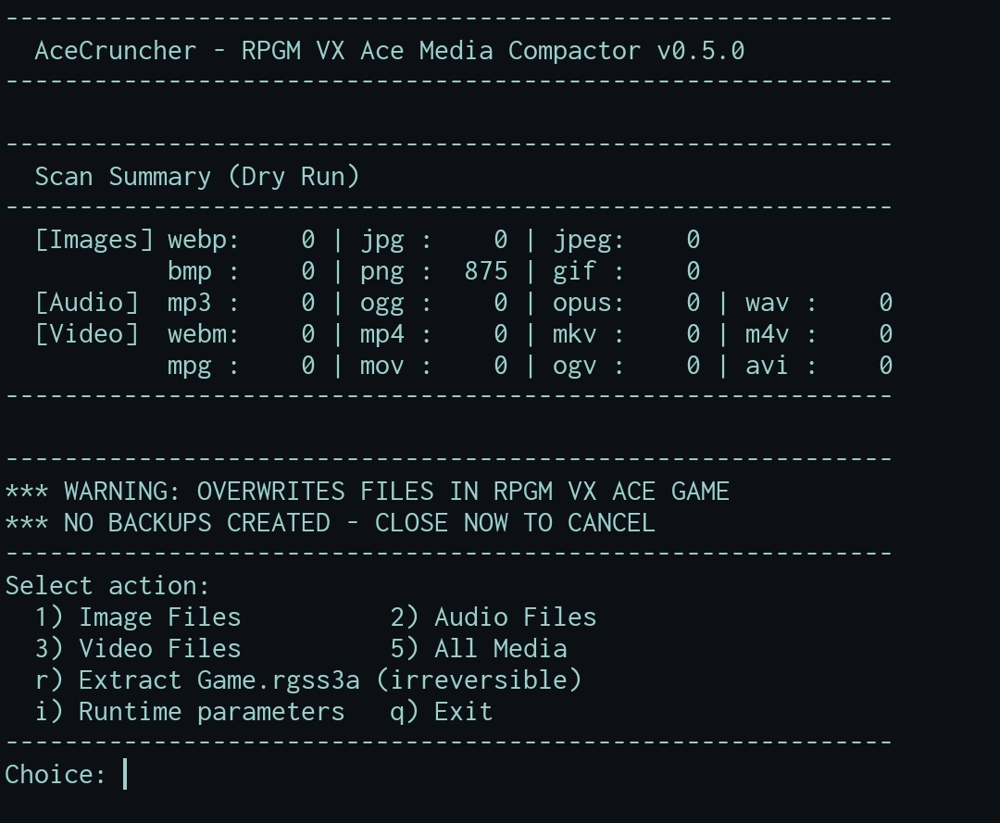
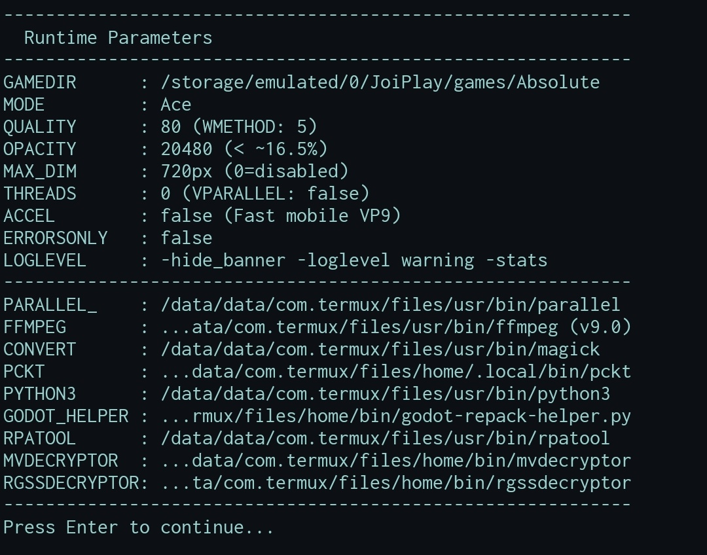

# Cruncher

A CLI/TUI tool for compressing media files in Ren'Py, RPG Maker (MV/MZ/VX Ace), and other HTML/Electron games.  
Based on [Cruncher by bas][Cruncher]; essentially a Linux/Termux port with extended functionality.

* [**Dependencies**](#dependencies)
* [**Features**](#features)
  + [**Screenshots (TUI)**](#screenshots-tui)
* [**Usage**](#usage)
  + [**Usage (tl;dr)**](#usage-tldr)
* **Guides:**
  + [**How to compress RPG Maker MZ games**](#how-to-compress-rpg-maker-mz-games)
  + [**How to unpack RPG Maker VX Ace game resources archive**](#how-to-unpack-rpg-maker-vx-ace-game-resources-archive)
  + [**How to compress RPG Maker MV games with .soldata files**](#how-to-compress-rpg-maker-mv-games-with-soldata-files)
  + [**How to compress Electron games with resources packed in an .asar file**](#how-to-compress-electron-games-with-resources-packed-in-an-asar-file)
    - [**How to create a Linux version of an Electron game**](#how-to-create-a-linux-version-of-an-electron-game)

## Dependencies

**Required:**
* `bash` (4.0+ for associative arrays) & GNU coreutils
* `ffmpeg` (supports v4.0+ and v5.1+/6.0+ automatically)
* `imagemagick` (supports both v7 `magick` and v6 `convert`)

**Optional (for extra features & speed):**
* `parallel` (GNU Parallel for multi-core batch processing)
* `python` / `mono` / `nodejs` (only required if using external archive/decryption helper tools)

## Features

Functionally, it does the same thing as the original Windows script: it re-encodes media files into lightweight formats
(WebP for images, Opus/Ogg/MP3 for audio, 2-pass WebM/OGV for video) **without changing file extensions**, expecting the game engine to detect file types by header/content rather than extension.

* **Multi-Engine Support:** Auto-detects and supports Ren'Py, RPG Maker (MV, MZ, VX Ace), and generic HTML/Other games.
* **Standalone & Portable:** Runs as a single standalone script that can be dropped directly into a game folder or installed globally (with optional symlinks like `RenCruncher`, `RPGMCruncher`, `AceCruncher`, or `OtherCruncher` to force a specific mode).
* **Zero Python Core:** Depends only on standard open-source packages; Ren'Py's `webp-header-fix` is built natively using GNU coreutils (`dd`/`stat`).
* **Safe Overwrites:** Never deletes files blindly—only overwrites the original if conversion succeeds and the new file is strictly smaller, while preserving original file permissions and timestamps.
* **TUI Progress & ETA:** Displays real-time terminal title progress, a progress bar with ETA in sequential mode, and a `--bar` progress meter when using GNU Parallel.
* **Hardware Acceleration:** Supports Intel/AMD VA-API VP9 hardware encoding (`-a`) for significantly faster video compression (also unlocks parallel video encoding), at the cost of slightly larger file sizes and minor quality loss in dark/3D scenes.
* **Built-in Archive & Decryption Integration:**
  * If [rpatool][rpatool] is detected, unpacks and repacks Ren'Py `.rpa` archives directly from the menu.
  * If [`MvDecryptor`][MvDecryptor] is detected, decrypts RPGM MV/MZ assets directly from the menu (including automatic encryption key extraction/detection).
  * If [`RgssDecryptor`][RgssDecryptor script] is detected, unpacks RPGM VX Ace `Game.rgss3a` archives directly from the menu.
* **See Also:** [Alternative tool RPGM MV/MZ][Alternative tool Rpgm MV MZ], [Alternative tool RPGM VX Ace][Alternative tool Rpgm VX Ace], and [Alternative tool Ren'Py][Alternative tool RenPy].

> [!NOTE]
> Some RPG Maker developers hardcode the encryption key into JS files instead of `System.json`. In `RPGM` mode, Cruncher automatically scans and prints keys found in both `System.json` and `js/` files on startup.

> [!NOTE]
> **RPG Maker VX Ace** does not support WebP or WebM. In `Ace` mode, images are converted to JPEG or PNG (based on transparency threshold) and videos are converted to 2-pass OGV (Theora/Vorbis). Size reduction is typically up to ~50% (compared to ~80% on Ren'Py/MV/HTML), and `-a` (VA-API) has no effect.

### Screenshots (TUI)

Main menu  


Runtime parameters view (adjust starting values via CLI flags or environment variables)  


## Usage

Run `cruncher` in your terminal from the main game directory (ensure `chmod +x cruncher` has been applied). You can either place the script inside the game folder and run `./cruncher`, or install it to `/usr/bin/cruncher` (along with any mode symlinks) to run `cruncher` globally.

You can pass configuration either as **CLI flags** (`./cruncher -m RenPy -q 80`) or **environment variables** (`MODE=RenPy QUALITY=80 ./cruncher`). You can also pass `MODE` as a standalone positional argument at the end (`./cruncher -a RenPy`).

### CLI Options & Environment Variables

| Flag | Env Variable | Default | Description |
| :--- | :--- | :--- | :--- |
| `-m MODE` | `MODE` | *(auto)* | Target engine: `RenPy`, `RPGM`, `Ace`, or `Other`. Auto-detected by folder layout or script symlink name if omitted. |
| `-d DIR` | `GAMEDIR` | *(by mode)* | Target resource folder (`./game` for Ren'Py, `./www` for RPGM, `.` for Ace/Other). |
| `-q QUAL` | `QUALITY` | `80` | WebP/JPEG compression quality percentage (`1`–`100`). |
| `-w METH` | `WMETHOD` | `5` | [WebP compression method][WebP method] (`0`–`6`). Higher values give better compression at slower speeds (`6` is noticeably slower than `5`). |
| `-o OPAC` | `OPACITY` | `20480` | PNG alpha transparency threshold (`0`–`65535`, default `20480` ≈ `16.5%`) used in `Ace` mode to decide between PNG and smaller JPEG files. |
| `-t THRD` | `THREADS` | `0` (`1` w/ `-v`) | Number of `ffmpeg` encoding threads (`0` = autodetect optimal; defaults to `1` when `-v` is active). |
| `-l LOG` | `LOGLEVEL` | `warning -stats` | Custom `ffmpeg` log flags (prepended with `-hide_banner -loglevel`). Pass `-` to disable custom log flags. |
| `-p` | `PRETEND` | `false` | Dry-run mode: scans and counts matching media files without modifying anything. |
| `-e` | `ERRORSONLY` | `false` | Quiet mode: prints errors only (`fatal -nostats`). |
| `-a` | `ACCEL` | `false` | Enable hardware VA-API VP9 video encoding (enables parallel video encoding if `parallel` is installed). |
| `-v` | `VPARALLEL` | `false` | Force parallel CPU video encoding (requires GNU `parallel`). |
| `-1` | `PARALLEL_` | *(auto)* | Disable GNU Parallel (`-`), or set `PARALLEL_` env var to a custom `parallel` binary path. |
| — | `VAAPI_DEVICE` | `/dev/dri/renderD128` | Hardware render device path used when `-a` (`ACCEL`) is enabled. |
| — | `FFMPEG` | *(auto)* | Path to the `ffmpeg` executable. |
| — | `CONVERT` | *(auto)* | Path to the ImageMagick executable (prefers `magick`, falls back to `convert`). |
| — | `RPATOOL` | *(auto)* | Path to [rpatool][rpatool] (`rpatool` or `rpatool.py`) for `.rpa` archive operations. |
| — | `MVDECRYPTOR` | *(auto)* | Path to [MvDecryptor][MvDecryptor] for RPGM MV/MZ asset decryption. |
| — | `RGSSDECRYPTOR` | *(auto)* | Path to [RgssDecryptor][RgssDecryptor script] for RPGM VX Ace archive extraction. |

> [!TIP]
> Passing `-h` or any unrecognized option prints the built-in CLI usage summary.

### Usage (tl;dr)

1. Install required packages: `bash`, `ffmpeg`, and `imagemagick` (plus `parallel` for faster multi-core processing).
2. Copy `cruncher` to `/usr/bin/` and mark it executable (`chmod +x /usr/bin/cruncher`).
3. Navigate to your unpacked game directory and run:
   ```bash
   cruncher
   ```
   * To force a specific engine mode: `cruncher RenPy` (or `RPGM`, `Ace`, `Other`).
   * For faster hardware-accelerated video compression: `cruncher -a`
   * For parallel CPU video compression (if your GPU lacks VP9 support): `cruncher -v`

---

## How to compress RPG Maker MZ games

1. In the main game folder, create a subfolder named `www/` and move all game subfolders (`audio/`, `data/`, `img/`, `js/`, `movies/`, etc.) into `www/`.
2. Run `cruncher` (auto-detects `RPGM` mode via `./www/data/System.json`).
3. Select **`d`** (decrypt MV/MZ files) or **`D`** (decrypt with auto-detected key) from the menu to decrypt `.ogg_`, `.m4v_`, and `.png_` assets using [`MvDecryptor`][MvDecryptor].
4. Select **`5`** (All Media) to compress all decrypted assets.
5. Move all folders back out of `www/` into the root game directory and remove the empty `www/` folder.

## How to unpack RPG Maker VX Ace game resources archive

If `RgssDecryptor` is in your `$PATH`, you can select **`r`** directly inside `AceCruncher` (runs `RgssDecryptor --proj Game.rgss3a` and removes the archive upon success).

To run manually via terminal in the game folder:
```bash
RgssDecryptor --proj Game.rgss3a
```
*(Note: `--proj` / `-p` generates the necessary placeholder file so the engine loads unpacked folders instead of looking for `Game.rgss3a`.)*

### Setup using Mono

1. Download [the modified Mono executable][RgssDecryptor] into a folder (e.g., `/usr/lib/rpgm/RgssDecrypter.exe`).  
   *(The modified binary fixes backslash path separators when running under Mono on Linux.)*
2. Create an executable wrapper script in your `$PATH` (e.g., `/usr/bin/RgssDecryptor`) with `chmod +x`:
   ```sh
   #!/bin/bash
   mono "/usr/lib/rpgm/RgssDecrypter.exe" "$@"
   ```
   *(A ready-to-use wrapper script is included in the `tools/` directory.)*

[How the executable was made][RgssDecryptor build]

### Setup using Wine (with unmodified executable)

1. Download and unpack [RgssDecryptor][RgssDecryptor windows] into a folder.
2. Set up a Wineprefix with `.NET` installed (e.g., using [Q4Wine][q4wine] and [Winetricks][winetricks] to install `dotnet45`).
3. Create a wrapper script in the same folder:
   ```sh
   #!/bin/bash
   DIR="$(dirname "$(readlink -f "$0")")"
   export WINEPREFIX="$HOME/.local/share/wineprefixes/NameOfYourWineprefix"
   wine cmd /c "$DIR/RgssDecrypter.exe" "$@"
   ```
4. Mark it executable (`chmod +x`) and symlink it into `$PATH`:
   ```bash
   sudo ln -s "$PWD/RgssDecryptor.sh" /usr/bin/RgssDecryptor
   ```

## How to compress RPG Maker MV games with .soldata files

1. Install [NodeJS][NodeJS].
2. Download the [soldata-decryptor][decryptor] archive (adapted for Linux from [this post][decryptor comment]).
3. Unpack it to `/usr/share/soldata-decryptor/`.
4. Symlink the script to your `$PATH`:
   ```bash
   ln -s "$PREFIX/share/soldata-decryptor/soldata-decryptor" "$PREFIX/bin/soldata-decryptor"
   ```
5. Run `soldata-decryptor` inside the game directory, then run `cruncher` as usual.

If the game fails to boot after compression, try deleting `www/data/precachelist.json`, or inspect `www/js/main.js` (the only difference from `www/js/main.js~` should be a `DataManager.loadDatabase` section added after `PluginManager.setup($plugins);`).

## How to compress Electron games with resources packed in an .asar file

Use the official [asar][asar] utility ([NPM][NodeJS] required), or the standalone [Asar alternative][Asar alternative]:

```bash
npm i -g @electron/asar # install globally (once)
cd ./resources
asar e app.asar app/    # extract resources archive
cruncher                # compress media in Other mode
asar p app/ app.asar    # repack archive with compressed assets
rm -rf app/             # remove temporary extracted folder
```

### How to create a Linux version of an Electron game (untested)

> [!NOTE]
> On Termux, you can install a prebuilt `electron` package directly from `tur-repo`.

Otherwise:
1. Download `electron-${VERSION}-linux-${PLATFORM}.zip` from [Electron Releases][Electron] (check the game's `version` file for the exact Electron version).
2. Unpack it into a temporary folder (e.g., `electron/`).
3. Remove Windows-specific files from the game directory: `locales/`, `swiftshader/`, `game.exe`, and `*.dll`.
4. *(Optional)* Remove unused files from the patch folder: `resources/`, `chrome-sandbox`, `crashpad_handler`.
5. Move the contents of the patch folder into the game directory, overwriting existing files.
6. Rename the `electron` binary to match the game's original executable name (e.g., `game`).


[Cruncher]: https://f95zone.to/threads/cruncher.10227/
[webp-header-fix]: tools/webp-header-fix.py
[parallel]: https://www.gnu.org/software/parallel/
[rpatool]: https://github.com/ddCeka/rpatool
[MvDecryptor]: tools/mvdecryptor
[RgssDecryptor script]: tools/rgssdecryptor
[WebP method]: https://manpages.debian.org/testing/webp/cwebp.1.en.html#m
[RgssDecryptor]: tools/RgssDecrypter.exe
[RgssDecryptor build]: tools/RgssDecrypter.md
[RgssDecryptor windows]: https://github.com/usagirei/RGSS-Decryptor/releases
[Alternative tool Rpgm MV MZ]: https://github.com/ddCeka/decvz
[Alternative tool Rpgm VX Ace]: https://github.com/ddCeka/rgss-dec
[Alternative tool RenPy]: https://github.com/ddCeka/rpa
[q4wine]: https://q4wine.brezblock.org.ua/screenshots
[winetricks]: https://github.com/Winetricks/winetricks#installing
[NodeJS]: https://nodejs.org/
[decryptor]: https://github.com/ddCeka/soldata-decryptor
[decryptor comment]: https://f95zone.to/threads/school-of-lust.6555/post-5448092
[asar]: https://www.npmjs.com/package/@electron/asar
[Electron]: https://github.com/electron/electron/releases
[Asar alternative]: https://github.com/ddCeka/asar
